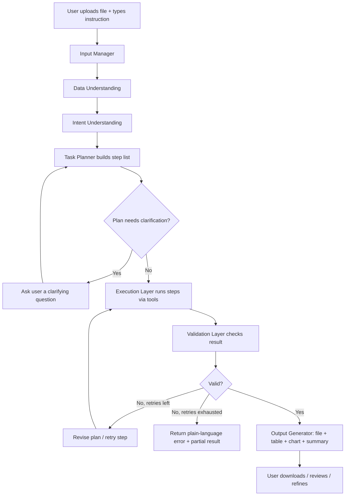
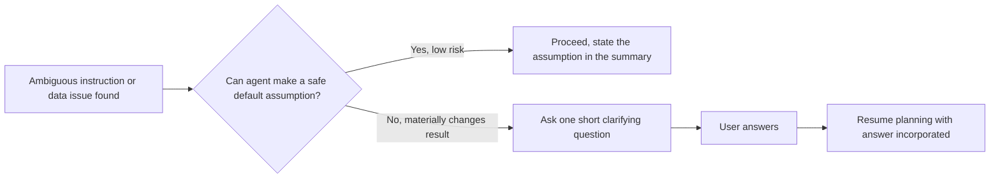

# flow.md — DataWise

How data and control move through the system, end to end.

---

## 1. High-Level User Flow

```
UPLOAD → UNDERSTAND → PLAN → EXECUTE → VALIDATE → EXPLAIN → DELIVER
```



---

## 2. System Architecture Flow

```
USER
 │
 ▼
DATAWISE UI  (upload + prompt)
 │
 ▼
INPUT MANAGER          → validates file, size/format checks, creates session
 │
 ▼
DATA UNDERSTANDING      → format detection, schema detection, profiling, type inference
 │
 ▼
INTENT UNDERSTANDING    → LLM parses prompt into discrete objectives
 │
 ▼
TASK PLANNER            → LLM converts objectives → ordered, tool-mapped step list ("the plan")
 │
 ▼
TOOL / EXECUTION LAYER  → deterministic code runs each step (pandas/numpy/sklearn/etc.)
 │                         (LLM does NOT touch the data directly here)
 ▼
VALIDATION LAYER        → automated checks against the plan's expected outcomes
 │
 ├─ fail (retries left) → back to TASK PLANNER (revise) → EXECUTION
 │
 ▼ pass
OUTPUT GENERATOR         → file, table, chart, plain-English "what changed" summary
 │
 ▼
USER
```

---

## 3. The Five Intelligence Stages (detail)

### Stage 1 — Data Understanding
Input: raw file
Output: a structured "data profile" object
- file type, encoding, sheet/table structure
- columns, inferred types (numeric / date / categorical / id / text)
- row count, null %, duplicate %, obvious quality flags

### Stage 2 — Intent Understanding
Input: user's natural-language prompt + data profile (so intent parsing is grounded in what's actually in the file)
Output: a list of objectives, each tagged to an operation category:
`clean | transform | aggregate | stat | ml | visualize | extract | compare | report`

Example: *"Clean this data and tell me which product generated the most revenue"* →
- Objective 1: `clean` (missing values, duplicates)
- Objective 2: `aggregate` (group by product, sum revenue, sort desc, top-1/top-N)

### Stage 3 — Task Planning
Input: objectives + data profile
Output: an ordered, numbered step list, where every step maps to exactly one tool-layer function. Example:

```
1. load_dataset()
2. drop_duplicates(subset=inferred_key)
3. handle_missing(strategy="median", columns=[...])
4. standardize_dates(column="Date", format="DD-MM-YYYY")
5. groupby_aggregate(by="Product", metric="Revenue", agg="sum")
6. sort_desc(column="Revenue")
7. top_n(n=10)
8. validate_result()
9. generate_output(format=["table","chart","file"])
```

This plan is the artifact the user (and Antigravity, if used for building) can review before execution.

### Stage 4 — Execution
- Each step is dispatched to a real function in the tool layer — never free-formed by the LLM
- Intermediate outputs are captured (for the diff/summary and for validation)
- Runs inside a sandbox: no arbitrary file system or network access

### Stage 5 — Validation
Automated post-execution checks, e.g.:
- row count didn't unexpectedly collapse to 0 or explode
- if cleaning was requested → null % actually dropped
- requested output (a column, a metric, a chart) actually exists in the result
- data types are as expected after transforms
- **On failure:** planner revises the plan (e.g. picks a different missing-value strategy) and re-executes, up to a retry cap. On exhausting retries: return a plain-language explanation plus whatever partial result is safe to show.

---

## 4. Example End-to-End Walkthrough

**Input:** `customer_data.xlsx`
**Prompt:** "Clean this data, remove duplicate customers, handle missing values, and show me the top 10 customers by total purchase."

1. **Understand data:** Excel detected, 1 sheet, columns `Customer_ID, Name, Age, Purchase, Region`; 4% nulls in `Age`, 12 duplicate `Customer_ID`s.
2. **Understand intent:** objectives = [clean (dedupe + missing values), aggregate (top-10 by Purchase)]
3. **Plan:** dedupe on `Customer_ID` → impute `Age` (median) → group irrelevant here (row-level ranking, not grouped) → sort `Purchase` desc → take top 10 → validate → output
4. **Execute:** pandas operations run each step; before/after row counts and null counts captured
5. **Validate:** duplicates = 0 ✅, nulls in Age = 0 ✅, output has exactly 10 rows ✅, sorted descending ✅
6. **Deliver:**
   - Cleaned Excel file (download)
   - Top-10 table rendered in UI
   - Summary: *"Removed 12 duplicate customers, filled 4% missing Age values with the median, ranked all customers by total purchase, and returned the top 10."*

---

## 5. Error / Clarification Flow



Rule of thumb: only interrupt the user when a wrong guess would silently produce a materially different or wrong result (e.g. "which date format do you want?" when three formats are mixed in one column). Don't interrupt for things a sensible default handles fine.

---

## 6. Conversational Refinement Flow (Phase 2+)

```
Result delivered
   │
   ▼
User: "now exclude region X"
   │
   ▼
Intent Understanding re-runs on the follow-up, WITH prior plan + result as context
   │
   ▼
Planner appends/modifies steps rather than starting over
   │
   ▼
Execute → Validate → Deliver (updated result)
```
